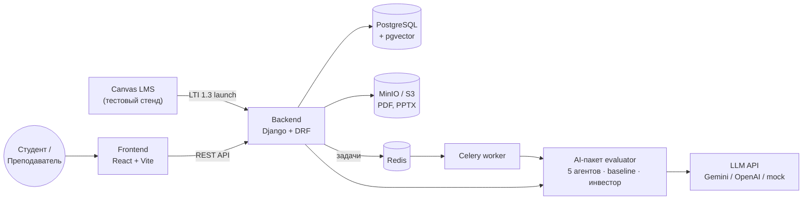

# AI Startup Evaluator

> Веб-приложение для предварительной оценки учебных стартап-проектов AI-агентами, встроенное в Canvas LMS через LTI 1.3.

Дипломный проект команды School of Digital Technology, Narxoz University.
Тема: **«Проектирование и интеграция AI-агентов в образовательные LMS-системы для автоматизированной оценки технологических стартапов»**.

[](https://github.com/OWNER/ai-startup-evaluator/actions/workflows/ci.yml)

---

## Содержание

- [Что делает система](#что-делает-система)
- [Принципы](#принципы)
- [Архитектура](#архитектура)
- [Технологии](#технологии)
- [Структура репозитория](#структура-репозитория)
- [Быстрый старт (Docker)](#быстрый-старт-docker)
- [Локальный запуск на macOS без Docker](#локальный-запуск-на-macos-без-docker)
- [Подключение AI-модели](#подключение-ai-модели)
- [Интеграция с Canvas (LTI 1.3)](#интеграция-с-canvas-lti-13)
- [API](#api)
- [Тесты](#тесты)
- [Безопасность и данные](#безопасность-и-данные)
- [Команда](#команда)
- [Как мы работаем с Git](#как-мы-работаем-с-git)
- [Дорожная карта](#дорожная-карта)

---

## Что делает система

| Функция | Описание |
|---|---|
| **Загрузка презентации** | Студент загружает PDF или PPTX. Система извлекает текст по слайдам. |
| **5 AI-агентов** | Рынок, бизнес-модель, финансы, технология, инновационность. Каждый агент оценивает свой критерий по шкале 1–5. |
| **Подтверждения** | Каждый балл сопровождается цитатой и номером слайда. Система сама проверяет, что цитата действительно есть в документе. |
| **Решение преподавателя** | AI даёт только предварительную оценку. Преподаватель может изменить баллы и утверждает итоговую оценку. |
| **Сравнение с одним AI** | Тот же кейс и та же рубрика оцениваются в режиме `single_ai`. Так мы проверяем, есть ли добавленная ценность от нескольких агентов. |
| **Виртуальный инвестор-ментор** | Тренировка питча: 5 минут выступления без перебиваний → 2–3 минуты вопросов → обратная связь. Таймер и смена этапов работают на сервере. |
| **Запуск из Canvas** | Приложение открывается внутри курса Canvas, роль (студент или преподаватель) приходит из LTI. |

## Принципы

1. **Человек принимает решение.** Итоговую оценку утверждает только преподаватель.
2. **Каждый балл проверяем.** Нет цитаты из документа — нет доверия к баллу.
3. **Честный эксперимент.** Мы не предполагаем заранее, что несколько агентов лучше одного AI-чата.
4. **Данные под контролем.** На старте используются только учебные и синтетические кейсы.
5. **Оцениваем проект, а не людей.** Никаких ярлыков и рейтингов студентов.

## Архитектура



**Как проходит AI-оценка:**

1. Студент загружает файл → backend сохраняет его и разбивает на слайды (`DocChunk`).
2. Создаётся `EvalRun` с режимом `multi_agent` или `single_ai` → задача уходит в очередь Celery.
3. Worker вызывает пакет `evaluator`: агенты работают параллельно, каждый по своему критерию.
4. Цитаты сверяются с текстом слайдов (`verified = true/false`).
5. Преподаватель открывает отчёт, при необходимости меняет баллы и утверждает оценку.

ER-диаграмма: [`docs/diagrams/erd.dbml`](docs/diagrams/erd.dbml) (откройте на [dbdiagram.io](https://dbdiagram.io)).

## Технологии

| Слой | Технология | Почему |
|---|---|---|
| Backend | Python 3.12, Django 5, Django REST Framework | Готовые админка, ORM, авторизация. Тот же язык, что и у AI-части. |
| LTI 1.3 | PyLTI1p3 | Поддерживает Django, берёт на себя OIDC, JWT, nonce и JWKS. |
| AI | Собственный пакет `evaluator` (httpx, pypdf, python-pptx) | Не зависит от Django, его можно тестировать и запускать отдельно для эксперимента. |
| Очередь | Celery + Redis | Оценка занимает десятки секунд, и интерфейс не должен ждать. |
| БД | PostgreSQL 16 + pgvector | Связанные данные, JSONB для ответов агентов, векторы для RAG в одной базе. |
| Файлы | MinIO (локально) / S3 (продакшн) | Закрытое хранилище, доступ по временным ссылкам. |
| Frontend | React 18, TypeScript, Vite | Быстрая разработка, типизация API. |
| Инфраструктура | Docker Compose, GitHub Actions | Одинаковое окружение у всей команды, автоматические проверки. |

## Структура репозитория

```
ai-startup-evaluator/
├── ai/                      AI-пакет evaluator (не зависит от Django)
│   ├── evaluator/
│   │   ├── agents/          BaseAgent и 5 специализированных агентов
│   │   ├── investor/        таймлайн питча и инвестор-ментор
│   │   ├── experiment/      метрики сравнения с экспертами
│   │   ├── prompts/         тексты промптов (.md)
│   │   ├── baseline.py      режим «один AI-ассистент»
│   │   ├── evidence.py      проверка цитат по документу
│   │   ├── extraction.py    извлечение текста из PDF/PPTX
│   │   ├── llm.py           клиент LLM: mock, OpenAI, Gemini
│   │   └── orchestrator.py  запуск оценки в выбранном режиме
│   └── tests/
├── backend/                 Django-проект
│   ├── config/              настройки, URL, Celery
│   ├── apps/
│   │   ├── accounts/        пользователи, курсы, роли, LTI-платформы
│   │   ├── projects/        проекты, команды, сдачи, документы
│   │   ├── rubrics/         рубрика и критерии
│   │   ├── evaluations/     запуски оценки, баллы, цитаты, решение преподавателя
│   │   ├── pitch/           сессии питча и этапы с таймером
│   │   ├── audit/           журнал действий
│   │   └── lti/             OIDC login, launch, JWKS
│   └── tests/
├── frontend/                React-приложение
│   └── src/
│       ├── api/             клиент API и типы
│       ├── components/      Timer и другие компоненты
│       └── pages/           Студент, Преподаватель, Отчёт, Питч
├── infra/
│   ├── canvas-test-stand/   инструкция по тестовому Canvas
│   ├── db/                  init.sql (pgvector)
│   └── lti/                 генерация RSA-ключей
├── docs/
│   ├── diagrams/            ER-диаграмма и UML-диаграммы
│   ├── rubric/              рубрика v0
│   └── thesis/              черновики текста диплома
├── data/synthetic/          только синтетические кейсы
├── .github/                 CI, шаблоны задач и PR, CODEOWNERS
├── docker-compose.yml
└── .env.example
```

## Быстрый старт (Docker)

Нужны: [Docker Desktop](https://www.docker.com/products/docker-desktop/) и Git.

```bash
git clone https://github.com/OWNER/ai-startup-evaluator.git
cd ai-startup-evaluator
cp .env.example .env
sh infra/lti/generate_keys.sh
docker compose up --build
```

В другом окне терминала:

```bash
docker compose exec backend python manage.py createsuperuser
docker compose exec backend python manage.py seed_demo
```

| Адрес | Что там |
|---|---|
| http://localhost:5173 | Интерфейс приложения |
| http://localhost:8000/admin/ | Админка Django |
| http://localhost:8000/health/ | Проверка, что backend работает |
| http://localhost:9001 | Консоль MinIO (`minioadmin` / `minioadmin`) |

**Демо-аккаунты** после `seed_demo`: `teacher`, `student`, `expert`. Пароль у всех: `demo12345`.
Войдите через «Войти (режим разработки)» на главной странице.

## Локальный запуск на macOS без Docker

```bash
brew install python@3.12 node postgresql@16 redis
brew services start postgresql@16
brew services start redis
createuser -s evaluator
createdb -O evaluator evaluator
```

Backend и AI-пакет:

```bash
python3.12 -m venv .venv
source .venv/bin/activate
pip install -e "ai[dev]" -r backend/requirements.txt
cp .env.example .env
set -a; source .env; set +a
sh infra/lti/generate_keys.sh
cd backend
python manage.py migrate
python manage.py seed_demo
python manage.py runserver
```

Worker (новое окно терминала, в папке `backend`, с активированным `.venv`):

```bash
set -a; source ../.env; set +a
celery -A config worker -l info
```

Frontend (новое окно терминала):

```bash
cd frontend
npm install
npm run dev
```

Для очень быстрого старта можно обойтись без PostgreSQL и Redis: задайте `DB_ENGINE=sqlite` и уберите `REDIS_URL`. Тогда оценка выполняется сразу, без очереди.

## Подключение AI-модели

По умолчанию стоит `LLM_PROVIDER=mock`. В этом режиме модель не вызывается, поэтому можно разрабатывать без ключей и без расходов.

| Провайдер | `.env` |
|---|---|
| Mock | `LLM_PROVIDER=mock` |
| Google Gemini | `LLM_PROVIDER=gemini`, `LLM_MODEL=<название модели>`, `LLM_API_KEY=<ключ>` |
| OpenAI | `LLM_PROVIDER=openai`, `LLM_MODEL=<название модели>`, `LLM_API_KEY=<ключ>` |

Чтобы добавить нового провайдера, добавьте метод в `ai/evaluator/llm.py`.
Промпты лежат в `ai/evaluator/prompts/`. При изменении промптов увеличьте `PROMPT_VERSION` в `ai/evaluator/config.py`: версия сохраняется в каждом запуске оценки и нужна для эксперимента.

## Интеграция с Canvas (LTI 1.3)

| Endpoint | Назначение |
|---|---|
| `/lti/login/` | OpenID Connect Initiation URL |
| `/lti/launch/` | Redirect URI / Target Link URI |
| `/lti/jwks/` | Публичный ключ инструмента (JWKS) |

Пошаговая инструкция по тестовому стенду и регистрации ключа: [`infra/canvas-test-stand/README.md`](infra/canvas-test-stand/README.md).

При запуске из Canvas система сама создаёт пользователя, курс и роль. Роли `Instructor`, `TeachingAssistant` и `Administrator` становятся ролью `instructor`, остальные — `student`.

> Тестовый стенд — это не копия Canvas Narxoz. Доступ к университетской системе пока не подтверждён.

## API

Все запросы требуют авторизации (сессия после LTI launch или входа в админку).

| Метод | Путь | Описание |
|---|---|---|
| GET | `/api/me/` | Текущий пользователь и его курсы |
| GET, POST | `/api/projects/` | Список проектов / создать проект |
| POST | `/api/projects/{id}/submissions/` | Загрузить PDF/PPTX (multipart, поле `file`) |
| GET | `/api/rubrics/` | Рубрики и критерии |
| POST | `/api/runs/` | Запустить оценку: `{"submission": "...", "mode": "multi_agent" \| "single_ai"}` |
| GET | `/api/runs/?submission={id}` | Все оценки по сдаче |
| GET | `/api/runs/{id}/` | Отчёт: баллы, обоснования, цитаты |
| POST | `/api/runs/{id}/review/` | Решение преподавателя: `{"overrides": [...], "comment": "..."}` |
| POST | `/api/expert-ratings/` | Оценка эксперта (для эксперимента) |
| POST | `/api/pitch/sessions/` | Создать сессию питча |
| GET | `/api/pitch/sessions/{id}/` | Состояние сессии и оставшееся время |
| POST | `/api/pitch/sessions/{id}/next/` | Перейти к следующему этапу |
| POST | `/api/pitch/sessions/{id}/messages/` | Ответ студента |

## Тесты

```bash
pytest ai/tests -q
cd backend && DB_ENGINE=sqlite pytest -q
cd frontend && npm run build
```

Что проверяется:
- проверка цитат: настоящая цитата находится, выдуманная отклоняется;
- оба режима оценки работают на одних и тех же критериях;
- таймлайн питча и метрики эксперимента;
- полный сценарий: загрузка PPTX → 2 режима оценки → решение преподавателя → питч из 3 этапов;
- LTI: JWKS, сопоставление ролей, создание пользователя и курса при запуске.

Те же проверки запускает GitHub Actions при каждом push и Pull Request.

## Безопасность и данные

| Риск | Решение |
|---|---|
| Подделка запуска из LMS | LTI 1.3: проверка подписи JWT по JWKS платформы, `nonce`, `state` |
| Доступ к чужим проектам | Роли из Canvas, проверка членства в команде или роли преподавателя на каждом запросе |
| Вредные или большие файлы | Только PDF/PPTX, лимит размера (`MAX_UPLOAD_MB`), хэш SHA-256 |
| Утечка файлов | Закрытое хранилище, временные ссылки (10 минут) |
| Prompt injection в презентации | Текст документа передаётся как данные внутри `<document>`, системный промпт запрещает выполнять из него команды, цитаты проверяются, решение принимает преподаватель |
| Передача работ внешним AI | Поле `consent_external_ai`: работы прошлых лет без согласия во внешние сервисы не отправляются |
| Секреты в коде | Ключи только в `.env`, файл в `.gitignore` |
| Злоупотребление API | Лимит запросов (`API_RATE_LIMIT`) |
| Аудит | Журнал действий `AuditLog`: загрузка, запуск оценки, утверждение, LTI launch |

**Правила по данным:** в репозиторий кладём только синтетические кейсы (`data/synthetic/`). Работы прошлых лет можно использовать только после проверки разрешений, включая передачу внешним AI-сервисам.

## Команда

| Участник | Роль | Зона в репозитории |
|---|---|---|
| Жайылған Гүлназ | Frontend Developer | `frontend/` |
| Узаков Ислам | Backend / LTI Engineer | `backend/`, `infra/` |
| Бисембаева Айгерим | AI Engineer | `ai/` |
| Мустафина Аружан | Research & Evaluation | `docs/rubric/`, `data/`, `ai/evaluator/experiment/` |
| Хисамиев Рамиль | Product / UX Research | `docs/`, бэклог в GitHub Projects |

Руководитель: Dr. Bliyeva.

## Как мы работаем с Git

**Ветки:**

| Ветка | Назначение |
|---|---|
| `main` | Стабильная версия, только через Pull Request |
| `dev` | Общая ветка разработки |
| `feature/<имя>-<задача>` | Ваша задача, например `feature/islam-lti-launch` |

**Порядок работы:**

1. Возьмите задачу в GitHub Projects и назначьте её на себя.
2. `git checkout dev && git pull`
3. `git checkout -b feature/<имя>-<задача>`
4. Делайте небольшие коммиты с понятным описанием: `feat: загрузка PPTX`, `fix: таймер этапа QA`, `docs: ER-диаграмма`.
5. Откройте Pull Request в `dev`, заполните шаблон, дождитесь 1 одобрения и зелёного CI.
6. Раз в неделю `dev` переносится в `main`.

**Правила кода:** без комментариев в коде, понятные имена функций и переменных, новые модели — сразу с миграциями (`python manage.py makemigrations`), изменения БД — также в `docs/diagrams/erd.dbml`.

Личный вклад каждого участника фиксируется через Issues, Pull Requests и коммиты.

## Дорожная карта

**MVP**
- [x] Загрузка PDF/PPTX и извлечение текста
- [x] 5 агентов и baseline «один AI»
- [x] Проверка цитат
- [x] Решение преподавателя
- [x] Сессия питча с серверным таймером
- [x] LTI 1.3: login, launch, JWKS
- [ ] Тестовый стенд Canvas и отчёт о трудоёмкости LTI
- [ ] Согласование рубрики с руководителем
- [ ] Тест ≥ 3 моделей для инвестора-ментора по времени
- [ ] Голос: запись → расшифровка → вопросы
- [ ] Экран эксперта и слепое сравнение
- [ ] UX-тестирование (≥ 8 участников)

**Будущее развитие (вне MVP)**
- Геймификация пути стартапа
- Интеграция с Canvas Narxoz после подтверждения доступа
- Живой голосовой диалог с инвестором
- Мобильное приложение

---

Учебный проект. Narxoz University, 2026–2027.
